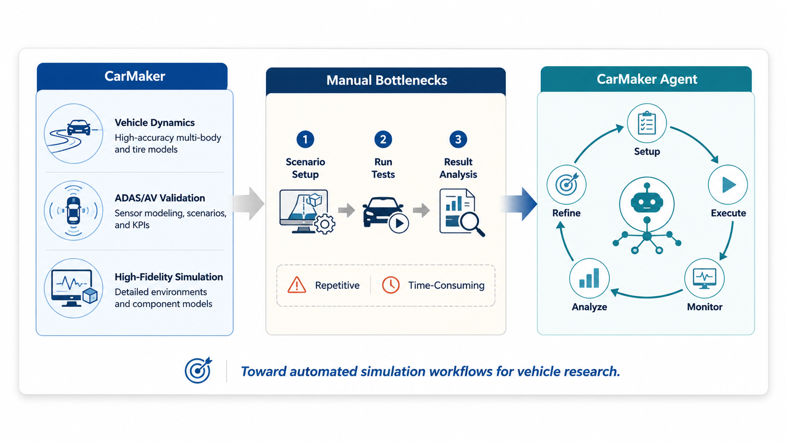
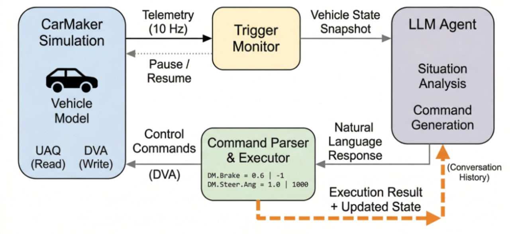
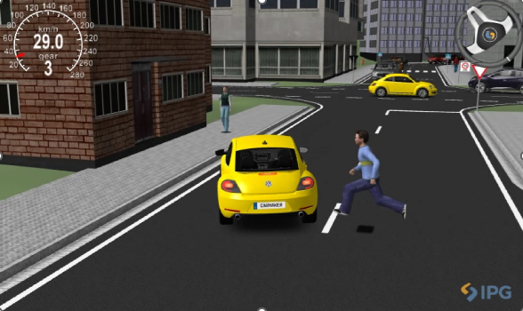
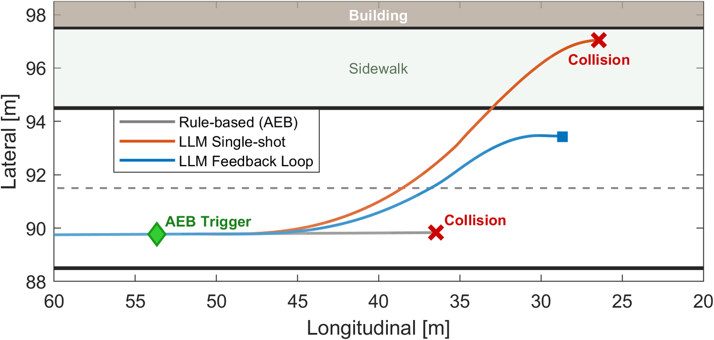
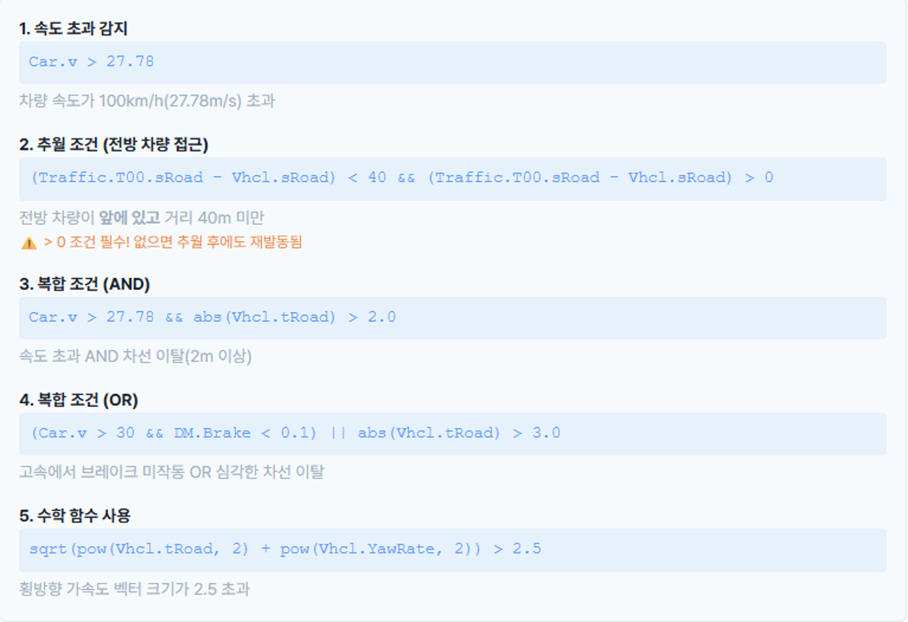

# CarMaker LLM Agent

CarMaker 자율주행 시뮬레이션에 LLM Agent를 연결하는 연구용 애플리케이션입니다.

> English: A research application that connects an LLM agent to autonomous driving simulations in CarMaker.

시뮬레이션 상태를 trigger가 감시하다가 조건이 맞으면 시뮬레이션을 멈추고, Claude CLI에 판단을 요청해 차량 제어 명령을 실행합니다. 채팅, 프롬프트 템플릿, telemetry, 규칙 기반 trigger를 한 화면에서 다룹니다.

## 소개

CarMaker는 차량 동역학, ADAS와 자율주행 검증, 고정밀 시뮬레이션을 제공합니다. 시나리오 설정, 시험 실행, 결과 분석은 사람이 반복해서 수행하는 작업이고 시간이 오래 걸립니다. 이 프로젝트는 설정, 실행, 모니터링, 분석, 보정을 LLM Agent가 하나의 루프로 수행하게 합니다.



## 동작 구조



1. CarMaker에서 10 Hz로 차량 telemetry(속도, 가속도, 조향각 등)를 받습니다.
2. trigger가 사용자가 정한 조건식을 평가합니다.
3. 조건이 맞으면 시뮬레이션 time scale을 0.001배로 낮춰 사실상 멈추고, 차량 상태 snapshot을 만듭니다.
4. snapshot과 프롬프트를 LLM에 보내 판단을 받습니다. 응답 지연(수 초)이 시뮬레이션 시간에 영향을 주지 않습니다.
5. 응답을 통합 명령 포맷으로 파싱해 순서대로 실행하고 time scale을 1.0배로 되돌립니다.
6. 실행 결과를 대화 이력으로 LLM에 다시 전달합니다(Feedback Loop). 같은 trigger는 5초 cooldown 동안 다시 발동하지 않습니다.

통합 명령은 제어 변수, 목표값, 지속 시간(ms)으로 구성되며 위에서 아래로 실행됩니다. `wait`은 지연을 넣고 `wait_until`은 차량 상태가 조건을 만족할 때까지 기다립니다.

## 주요 기능

- 채팅: LLM과 대화하며 시뮬레이션을 조작합니다.
- 프롬프트 템플릿: 시나리오별 판단 전략을 프롬프트로 바꿉니다. 재학습이 필요 없습니다.
- telemetry: 차량 상태를 실시간으로 확인합니다.
- 규칙 기반 trigger: 속도, 종가속도 같은 변수의 비교식으로 LLM 호출 시점을 정합니다.
- 독립 실행 도구: 제어, 모니터링, catalog, 실험 스크립트를 Python으로 단독 실행합니다.

## 실험 예시: 보행자 긴급 회피

정차한 버스 뒤 사각지대에서 보행자가 무단횡단하는 도심 시나리오입니다. CarMaker의 AEB 테스트 시나리오에서 차량 속도를 약 65 km/h(18.1 m/s)로 높여, 제동만으로는 회피하기 어렵게 구성했습니다. LLM은 Claude Sonnet 4.6을 사용했습니다.



세 가지 제어 방식을 비교했습니다.

| | Rule-based | LLM Single-shot | LLM Feedback Loop |
|---|---|---|---|
| 제동 입력 [0~1] | AEB only | 0.5 | 0.6 |
| 조향 입력 [rad] | - | 1.4 | 1.0 |
| 결과 | 보행자 충돌 | 건물 충돌 | 회피 |

- Rule-based: 직진 후 보행자와 충돌합니다.
- Single-shot: 제동과 조향을 함께 쓰는 회피를 시도하지만, 1회 판단으로는 조향량을 검증하지 못해 과조향으로 보도 영역의 구조물과 충돌합니다.
- Feedback Loop: 1차 실행의 실패 결과(과도한 조향과 이탈)를 LLM이 분석해 제동력을 높이고 조향각을 줄입니다. 차로 안에서 보행자를 회피합니다.



## trigger 조건 예시

화면에서 조건식을 직접 만들고 여러 trigger를 등록합니다.



## 구성 요소

```text
SvelteKit / Svelte 5 UI
         | HTTP
FastAPI backend ---- Claude CLI (별도 인증)
         | TCP command interface
라이선스를 가진 CarMaker 설치본과 시뮬레이션 프로젝트
```

- `v3/apps/frontend/`: 브라우저 인터페이스.
- `v3/apps/desktop-electron/`: 데스크톱 셸과 네이티브 대화상자.
- `v3/services/python-api/`: API, 로컬 저장소, 명령 실행, trigger 루프.
- `workspace/carmaker_llm_scenario_skill/agent/`: 독립 실행 Python 제어, 모니터링, catalog, 실험 도구.
- `MapGenerator/`: API가 쓰는 선택 기능인 지도 embedding과 검색 스크립트.

## 요구사항

- 번들 데스크톱 launcher는 Windows용입니다. Python 3.11 이상, Node.js 20.19+ 또는 22.12+가 필요합니다.
- 별도 라이선스의 IPG CarMaker와 TCP command interface 활성화, 사용 권한이 있는 프로젝트와 TestRun이 필요합니다. CarMaker 소프트웨어, 매뉴얼, 라이브러리, 헤더, 샘플 데이터는 포함되어 있지 않습니다.
- LLM 판단에는 설치와 인증을 마친 Claude CLI가 필요합니다. 인증 정보와 사용 요금은 별도로 관리합니다.
- 지도 embedding(선택)에는 `OPENAI_API_KEY`, 색인된 지도 collection, 네트워크가 필요합니다.

## 설치와 실행

저장소 루트의 PowerShell에서 실행합니다.

```powershell
python -m venv .venv
.venv/Scripts/python.exe -m pip install -e "./v3/services/python-api[dev]"
cd v3/apps/frontend
npm ci
cd ../desktop-electron
npm ci
cd ../../..
```

서비스는 터미널을 나눠 각각 실행합니다.

```powershell
# Backend (저장소 루트)
.venv/Scripts/python.exe -m uvicorn app.main:app --host 127.0.0.1 --port 8000
# Frontend
cd v3/apps/frontend
npm run dev
# Desktop shell (다른 터미널)
cd v3/apps/desktop-electron
npm run dev
```

Windows에서는 `v3/start_v3_dev.bat`가 서비스별 환경을 만들고 세 구성 요소를 한 번에 시작합니다. launcher가 출력하는 backend 포트의 URL을 Agent에 사용합니다. Frontend는 `http://127.0.0.1:4173`에서 열립니다.

연결 전에 애플리케이션에서 CarMaker의 host와 TCP command 포트를 설정하고, 설정에서 Claude workspace를 지정합니다. backend는 새 데이터를 사용자 application-data 폴더의 `CarMaker-LLM-Agent`에 저장하며 `DATA_DIR`로 위치를 바꿀 수 있습니다. backend 설정 예시는 `v3/services/python-api/.env.example`에 있습니다.

독립 실행 도구의 사용법은 다음 명령으로 확인합니다.

```powershell
python workspace/carmaker_llm_scenario_skill/agent/carmaker_research_runner.py --help
```

catalog와 실험 명령에는 `CARMAKER_ROOT` 환경 변수나 `--carmaker-root`를 지정합니다. `--backend-url`은 직접 넘겨야 합니다. 이전 독립 도구는 기본값이 8010 포트입니다. 사용 권한이 있는 프로젝트와 TestRun을 직접 준비하고, 생성된 catalog와 보고서는 로컬에 둡니다.

## 검증

```powershell
.venv/Scripts/python.exe -m pytest v3/services/python-api/tests
cd v3/apps/frontend
npm run check
npm run build
```

## 한계

연구 프로토타입입니다. 실제 CarMaker 연동, LLM 판단, 유료 embedding 호출은 사용 환경에서 따로 검증해야 합니다. telemetry는 polling 방식입니다. 데이터베이스 import와 export는 파일 복사로 동작하므로 쓰기 중에는 수행하지 않습니다. 포함된 테스트는 격리된 데이터를 사용합니다. 벤치마크 데이터와 논문 실험 결과 원본은 포함되어 있지 않습니다.

## 인용

지경태, 원동열, 고찬혁, 한경석. "LLM 에이전트를 활용한 CarMaker 기반 자율주행 시뮬레이션 의사결정 시스템." 한국자동차공학회 2026 춘계학술대회.

> Kyoungtae Ji, Dongyeol Won, Chanhyeok Ko, and Kyoungseok Han. "LLM Agent-Based Decision-Making System for Autonomous Driving Simulation in CarMaker." KSAE 2026 Spring Conference.

## 사사

이 연구는 2025년도 정부(과학기술정보통신부)의 재원으로 정보통신기획평가원의 지원을 받아 수행된 연구임 (No.RS-2025-25422680, Meta cognitive AGI Framework and its Applications)

> This work was supported by the Institute of Information & Communications Technology Planning & Evaluation (IITP) grant funded by the Korea government (MSIT) (No. RS-2025-25422680, Meta cognitive AGI Framework and its Applications).

## 라이선스

MIT License, Copyright 2026 VOICE Lab, Hanyang University. 서드파티 의존성은 각자의 라이선스를 따릅니다.
